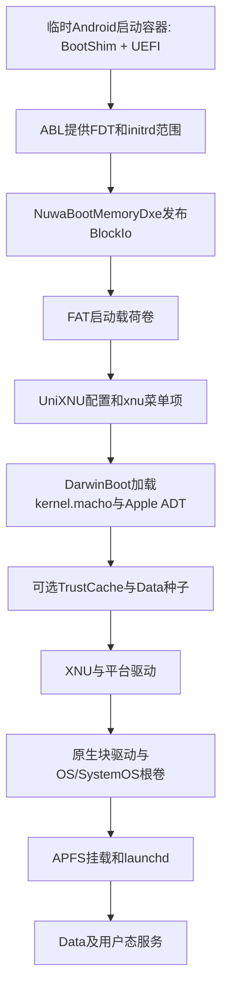

# iOS 16系统卷、启动载荷与内核接入预研

2026-10-23，离线研究。范围包含用户补充的启动载荷；不生成系统/启动镜像、不运行prelink、不修改board/bringup-plan/feed/验证标志、不操作手机。本报告是后续实施候选，不是新的板值或刷写批准。

## 结论

后续应分四个交付物：FAT启动载荷卷、Darwin22预链接内核与Apple ADT、iOS只读OS/SystemOS根镜像、可写Data种子。当前已具备源内核、donor组件及FAT工具证据，尚缺稳定的固件接入、真实载荷运输、当前内核的合格预链接、nuwa ADT和根存储驱动。今晚2d833461诊断包继续保持不变，不把这些工作混入同一次对照试验。

本次新证据：

- 当前77742999内核实际符号表有ArmCpu/ArmDTPlatform观测导出，没有NativeUfs、NativeRamBlock的对应导出或命名符号，也没有_sheng_pmgr_run；已有源内核不具备官方完整原生根卷链。见kernel-providers.json。
- 本机已有iPhone10,3/d22ap/16.7.16/20H392的7项donor组件，OS、SystemOS、AppOS文件都在。大DMG只复核文件长度和UDIF尾签名，本轮未重新全文件计算SHA；原抓取SHA另列，不能混称本轮重验。
- 两份原始TrustCache本轮重新计算SHA并解IM4P，实际均为v2；2760与61个条目、长度/哈希类型/排序静态检查通过。原模块不变时，内存中可组出67764B双模块包，SHA eb1475f643f45a974ebd40596f6e2b1cdf40205d2ca3c6094d774886099399c3，未写出二进制，未声称Apple签名或运行认证通过。
- 固定75bc13dd的DarwinBoot与NativeRamBlock稀疏布局限制为输入不超过256MiB、packed逻辑长度不超过2GiB；官网10月22日缓存描述的1TiB能力不能套用。skip-setup和原始trust构建脚本还含iPad17固定身份，不能原样执行。
- 隔壁现存预链接报告的native SHA为89d8ff86，不是当前77742999；只能参考分析，不能称本仓当前内核已预链接完成。

证据目录：[reports/ios16-payload-research](../../reports/ios16-payload-research/)。脚本scripts/research-ios16-payload-chain.py只读固定Git对象、缓存donor及现有内核，输出JSON；命令为`python -X utf8 -B scripts/research-ios16-payload-chain.py`，新输出目录存在时拒绝覆盖。

## 1. 启动载荷和系统卷的关系



FAT是UEFI读取启动文件的载体；iOS根文件系统由XNU块设备/APFS链提供，不能将DMG放进FAT就认定根卷可挂载。外层Android header的ramdisk、FAT内entry.initrd所指Data文件、iOS根卷，是不同对象。

官方payload.py的目标布局（固定75bc13dd，具体行号/SHA见source-contracts.json）：

```text
EFI/UniXNU/unixnu.toml
EFI/UniXNU/Payloads/kernel.macho
EFI/UniXNU/Payloads/kernel.macho.adt
EFI/UniXNU/Payloads/kernel.macho.trustcache   # 提供trust输入时
EFI/UniXNU/Payloads/scratch-data.img         # 提供Data输入时
```

固件已内置DarwinBoot，当前不需要再往FAT放一份不同版本EFI。payload.py会写xnu菜单项、相对路径和args；先用标记菜单确认卷发现，再接内核，避免将挂载错误与内核问题混合。

现有64MiB FAT配置探针bc0b3eae完成WSL mtools读回和fsck检查，但还未接入实机。原厂ABL可能把vendor/generic/bootconfig拼成整个initrd，当前发布器要求整段整扇区；不能只追加FAT、擅自四舍五入/chosen end或凭Android快照填偏移。今晚先取得SHENGMEM实际范围，再选择载荷运输方式。

## 2. 内核与Apple ADT

源内核77742999已在macOS CI39793231214编译，Darwin22/8796.141.3、4KiB，零未解析外部符号；主机ParseKernel接受。完整iOS路径还要从同一iPhone donor的kernelcache取得Apple组件，与当前源内核做合格NativePrelink。

官方kernel.py明确依赖kernelcache哈希、roots、slide、early_security_init及工具/输入内核。不得用sheng/fuxi的iPad17值填空；这些值须由本次donor和当前native分析形成只读plan。现有65348项指针名闭包零失败不证明布局/PC-relative/运行ABI。12处外部PC-relative编码（含4处ADRP）尚未验收；本轮不放宽检查、不执行带豁免的emit。

参考预链接native SHA89d8ff86与当前77742999不同，原donor均指2ec297ba；reference-prelink.json保存报告哈希及差异，不采纳旧slide/roots等值。

Apple ADT是kernel.macho.adt，不是把ABL的Linux FDT改后缀。CPU/GIC/timer/PSCI可从缓存nuwa FDT提供事实来源；还需平台专家要求的/cpus、/arm-io、/defaults、/options和CHRP NVRAM proxy。CPU affinity 0、0x100…0x700的映射、硬件IRQ及接管语义尚未验证。

按实际输入生成/chosen/memory-map中的16B零占位符：有Data才有RAMDisk或PackedRAMDisk；两者不能并存，packed要求DBRDISK1格式；有trust文件才有TrustCache。无输入留下对应槽位也会被拒绝。沿用Darwin22的608B命令行/0x2e0 boot_args补丁，不采用官网通用页中的Darwin23布局。

D-002仍先512MiB—1GiB连续窗口过阶段5，硬上限8GiB。首次入口包不承载完整OS或大Data。真正落地board/bringup-plan的窗口、基址和既有身份字段仍触发审阅；本预研只记录缺口。ipad_identity=true仍是四个/chosen安全属性，与iOS/iPadOS目标无关。

## 3. TrustCache与Data种子

| 原始组件 | 本轮实读结果 | 使用前还需做的事 |
| --- | --- | --- |
| StaticTrustCache | IM4P SHA63e01c03，解出66264B，v2/2760条，模块SHA b7ab28e0 | 绑定当前donor、输出包清单及实际DarwinBoot验收 |
| Cryptex1,SystemTrustCache | IM4P SHA9cc478fe，解出1488B，v2/61条，模块SHA8aae4c42 | 同上；不能用别的build的系统cache替换 |
| Data种子 | 本次已检查的旧.work范围没有找到可直接采用的dbr/匹配Data镜像 | 生成或取得iOS16匹配APFS Data种子，核对UUID、权限、系统组目录及启动策略 |

当前原始trust构建脚本build-original-system-trust.py写死iPad7,1/j120ap/21H461及两份哈希；不得import运行它去处理iPhone16。可复用其DER/封包算法，改成显式donor组件输入并保留原模块内容；本次只在内存研究了这种封包。

Dense Data会在DarwinBoot窗口内占用展开后的全部空间；PackedRAMDisk保留打包数据时也需要内核端NativeRamBlock和对应挂载接线。固定PackedRamdisk.h:16/22及SparseDisk.h:13/15均有限制：输入256MiB、逻辑长度2GiB、4KiB对齐、至多65536段。大Data种子不能直接交给当前版本，稀疏不等于没有元数据/驻留页成本。

seed-data-skip-setup.py:27将BUILD/VERSION写成21H461/17.7.11，迁移偏好也依赖build；未来改为20H392/16.7.16需独立适配和种子副本审查。跳过Setup不等于激活成功、launchd稳定或显示触控驱动就绪，不把其他板禁用服务名单整份带入nuwa。

## 4. iOS系统镜像与原生根卷

本机既定donor组件：

| 组件 | 文件 | 文件长度 | 状态 |
| --- | --- | --- | --- |
| OS | 087-86698-044.dmg | 4730814044B | 本机存在，UDIF koly；原抓取SHA80f426d5，本轮未重新全盘哈希 |
| SystemOS | 087-86593-047.dmg | 2743074816B | 本机存在，UDIF koly；原抓取SHA9cd738f3，本轮未重新全盘哈希 |
| AppOS | 087-86715-047.dmg | 10485760B | 本机存在；是否独立发布/挂载按iOS16实际用户态需求确认，不擅自丢弃 |

userdata.py使用hdiutil只读attach、读取解码后的整个原始磁盘，再写SHNGROOT manifest。不能把上表DMG文件长度当成raw窗口大小，也不能把UDIF压缩文件直接拼接为APFS块设备。manifest为4096B，首个窗口1MiB对齐；OS/SystemOS窗口、原始磁盘哈希、APFS根卷UUID和实际分区容量均须单独取得。

root_match_volume_uuid必须来自真正的目标OS卷。userdata的first_lba/last_lba/lba_bytes必须来自本机GPT及块语义；SHNGROOT内部block_size=512不等于UFS或GPT逻辑块尺寸。当前都不落地，不填示例UUID/LBA。

推荐后续复用官方NativeUfs和NativeRamBlock真实实现，先只读核查根存储链。NativeUfs.cpp含sheng具体SMMU/MMIO/stream与队列接管依据；同SM8550只支持作为候选，不证明nuwa相同。需核对nuwa的控制器/PHY/GCC、SMMU sid/上下文、LUN/GPT、4KiB DMA兼容和读命令，再编入8796并验收。NativeRamBlock还需要存储/AES预链接闭包及Data挂载接线。

官方payload.py:46—52对native-ufs-root要求单个sheng-pmgr=2及_sheng_pmgr_run；当前内核无该导出，不能加一个启动参数冒充已接入PMGR。此处先评估8796及iPhone donor AMFI/电源provider的真实依赖，不抄另一板的运行配置。

只读OS/SystemOS不意味着userdata载体也不会被改。写userdata会影响现有Android Data；现有恢复证据仅证明临时boot恢复，**不覆盖改写userdata之后的Android恢复**。未来选择实际存储目标前，要有目标、完整数据恢复/备份路径与具体日志依据；本轮没有执行刷写，也没有据一般授权认定恢复已具备。

## 5. 候选路线与代价

| 路线 | 用途与代价 | 当前判断 |
| --- | --- | --- |
| 小FAT探针→内核入口包→原生UFS根卷 | 每阶段隔离一层，先解决运输/ADT/EL1，再适配UFS/APFS；最终还需iOS16 Data和用户态服务 | 倾向；最符合官方七阶段与现有证据 |
| 直接把全套OS/Data放RAM | 省早期持久存储步骤，但多GiB系统镜像与首次512MiB—1GiB窗口冲突，当前loader/Data上限也不支持随意扩大 | 不作为首次入口方案，不拿稀疏Data能力替代完整OS的内存预算 |
| USB/其他独立介质作根卷 | 可减少改Android userdata，但XNU侧USB/UFS桥和介质驱动、枚举/供电/根挂载都要新增验收；UEFI能见USB不等于XNU能用 | 后备候选，当前无更快可落地证据 |

这些是研究倾向，没有批准新的板参数、写入目标或持久Data store。首次Data可先评估易恢复的RAM方案，持久化放到根卷只读验收之后。

## 6. 后续实施与验收顺序

1. 保持今晚诊断候选，完成SEC→DXE→UniXNU稳定性和SHENGMEM实测；恢复Android完成1。
2. 接入只含标记配置的FAT探针，取得正确整段范围、BlockIo→Fat→SimpleFileSystem→配置路径的实机证据；没有数据时不猜偏移。
3. 对当前77742999＋同一iPhone donor生成只读prelink计划，解决12处编码证据及初始化ABI，补齐nuwa ADT候选审查。源内核与预链接产物分别建清单，不复用隔壁输入哈希。
4. 先做最小阶段4/5载荷，不带完整iOS根镜像或大Data；验收DarwinBoot拒绝/返回路径、连续窗口、EL1及XNU平台专家。板参数落地前走既有审阅门。
5. macOS只读处理已缓存DMG，取得raw大小/哈希/卷UUID；WSL继续负责FAT、manifest及格式检查。macOS hdiutil能力与Linux DMG转换替代方案分开记录，不声称WSL已能运行官方完整根卷步骤。
6. 适配NativeUfs等8796后端，先读LUN/GPT及manifest、发布只读OS/SystemOS，再验收APFS根挂载和launchd。
7. 补iOS16 Data、trust和用户态策略，逐服务验证显示/触控、launchd、SpringBoard与稳定性；进入内核、挂根卷和进入界面分别记录，均不能互相替代。

## 来源与证据限制

官方概念页payload/userdata/prelink、porting/device-tree、boot-configuration、skip-setup和sheng本轮通过网页工具及HTTP访问失败（7页均404）；使用10月22日已存HTML，official-pages.json记录URL/时间/完整SHA。本报告不称已读取官网最新内容。

实现以UniXNU/UniXNU@75bc13dd34dc4e403826793739e316a264ce00dd和UniXNU-sheng@a599a1a8a92093b5077543e071b72130769eb325为固定来源，source-contracts.json记录逐文件SHA、行号及许可。两仓根LICENSE为BSD-2-Clause-Patent；NativeUfs独立LICENSE为BSD-2-Clause、源码SPDX为BSD-2-Clause-Patent，未来分发前需厘清并保留通知。本次未复制实现、未采用sheng板值或iPad17 prelink字段。

所有结果是文件/格式/符号静态审查，没有QEMU、EFI或实机运行结论。没有生成系统镜像、预链接内核或目标ADT；没有把任何_verified设true。
